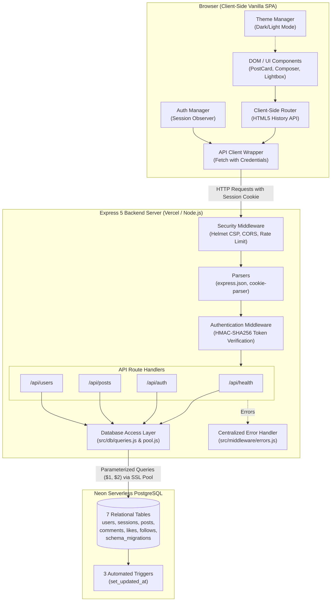
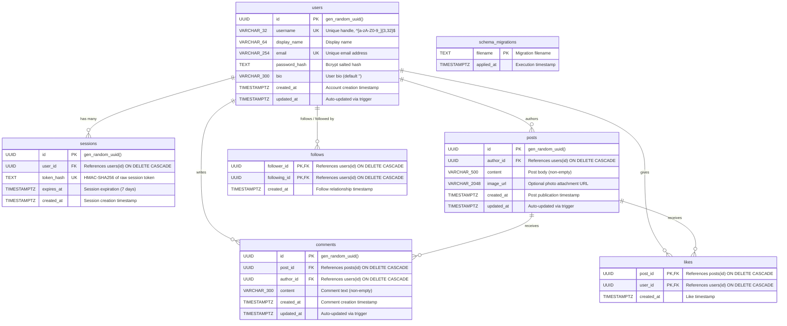

# Nexus — Modern Full-Stack Social Media Platform

[](https://nodejs.org/)
[](https://expressjs.com/)
[](https://neon.tech/)
[](https://code-alpha-social-media-platform-nine.vercel.app/)
[](https://jestjs.io/)
[](#17-testing--quality-verification)
[](LICENSE)

> **CodeAlpha Full Stack Development Internship — Task 2**  
> A production-ready, feature-rich social networking platform built with a high-performance **Express 5** REST API, serverless **Neon PostgreSQL** database, and a custom **Vanilla JavaScript Single-Page Application (SPA)** featuring a dual-theme desktop dashboard experience.

---

## Live Links & Quick Reference

| Resource | Link |
|---|---|
| **Live Production Application** | [https://code-alpha-social-media-platform-nine.vercel.app/](https://code-alpha-social-media-platform-nine.vercel.app/) |
| **GitHub Source Repository** | [https://github.com/Jogesh-Joshua/CodeAlpha_SocialMediaPlatform](https://github.com/Jogesh-Joshua/CodeAlpha_SocialMediaPlatform) |
| **API Health Endpoint** | [https://code-alpha-social-media-platform-nine.vercel.app/api/health](https://code-alpha-social-media-platform-nine.vercel.app/api/health) |
| **Author** | Jogesh Joshua |
| **Internship Program** | CodeAlpha Full Stack Development Internship (Task 2) |

---

## Table of Contents

1. [Project Overview](#1-project-overview)
2. [Key Features](#2-key-features)
3. [User Interface & Visual Design](#3-user-interface--visual-design)
4. [Technology Stack](#4-technology-stack)
5. [Application Architecture](#5-application-architecture)
6. [Project Directory Structure](#6-project-directory-structure)
7. [Database Architecture & Schema](#7-database-architecture--schema)
8. [Complete REST API Reference](#8-complete-rest-api-reference)
9. [Authentication & Security Engineering](#9-authentication--security-engineering)
10. [Local Installation & Setup Guide](#10-local-installation--setup-guide)
11. [Environment Variables Reference](#11-environment-variables-reference)
12. [Database Migrations & Seeding](#12-database-migrations--seeding)
13. [Testing & Quality Verification](#13-testing--quality-verification)
14. [Production Deployment Architecture](#14-production-deployment-architecture)
15. [User Interface Showcase & Screenshots](#15-user-interface-showcase--screenshots)
16. [Known Limitations & Design Considerations](#16-known-limitations--design-considerations)
17. [Future Enhancements Roadmap](#17-future-enhancements-roadmap)
18. [Internship Attribution & Evaluation](#18-internship-attribution--evaluation)
19. [License](#19-license)

---

## 1. Project Overview

### What is Nexus?
**Nexus** is an open, modern social media platform tailored for creators, developers, designers, and students to publish content, exchange ideas, follow peers, and build meaningful networks. 

### Problem Statement & Solution
Many contemporary social media platforms are bloated with heavy client-side bundles, opaque recommendation algorithms, aggressive tracking, and cluttered feeds. Nexus solves this by returning to the fundamentals of web engineering:
- **Zero Framework Bloat:** Developed completely with **Vanilla HTML5, CSS3, and JavaScript (ES6+)** without React, Vue, or Angular runtime overhead.
- **Instant Response Times:** Sub-50ms server responses powered by Express 5, connection pooling on Neon PostgreSQL, and an optimized client-side SPA router.
- **Relational Integrity:** Pure relational data modeling using strict foreign keys (`ON DELETE CASCADE`), composite unique constraints, check constraints, and transactional query abstractions.
- **Privacy & Security First:** HttpOnly session cookies carrying cryptographically secure HMAC-SHA256 hashed session identifiers, salted bcrypt password hashing, and strict Content Security Policies.

### Target Users & Primary User Journey
1. **Discovery & Onboarding:** Guests land on a curated global feed with an interactive creator story strip, trending topics, and photo showcases.
2. **Registration & Session Creation:** Users sign up with a unique username, display name, email, and password. A 7-day secure HttpOnly cookie is issued immediately.
3. **Content Publishing:** Creators post updates with live character counts, hashtag detection (`#webdev`, `#photography`), and high-resolution photo attachments.
4. **Community Engagement:** Users like posts with instant counter toggles, leave threaded comments, and copy direct permalinks.
5. **Network Building:** Users follow creators, transforming their experience through a dedicated "Following" feed that aggregates updates exclusively from followed profiles.
6. **Profile Customization:** Users personalize their public profiles with bios and display names while monitoring follower, following, and post counts.
7. **Personalized Experience:** Users toggle seamlessly between Dark Mode and Light Mode with preferences saved in `localStorage`.

---

## 2. Key Features

### Authentication & Session Management
- **Registration & Validation:** Strict validation for usernames (`^[a-zA-Z0-9_]{3,32}$`), emails (`RFC 5322`), passwords (minimum 8 characters), and display names.
- **Duplicate Prevention:** Immediate conflict detection (`HTTP 409`) on existing usernames or email addresses.
- **Salted Password Hashing:** Powered by `bcryptjs` (12 rounds in production/dev, 4 rounds in testing).
- **HMAC-SHA256 Session Handling:** Tokens generated using 32 cryptographically random bytes (`crypto.randomBytes(32)`). Only the HMAC-SHA256 hash is stored in PostgreSQL; raw tokens reside exclusively in `HttpOnly`, `SameSite=Lax`, `Secure` cookies.
- **Session Lifecycle:** Persistent authentication across browser restarts, active `/api/auth/me` state checks, and clean server-side session invalidation on logout.

### User Profiles & Follow Relationships
- **Public Creator Profiles:** Unique URL routes (`/profile/:username`) displaying avatar, display name, handle, bio, join date, follower count, following count, and post gallery.
- **Profile Customization:** In-place modal dialog allowing users to update their display name and bio (`PUT /api/users/me/profile`).
- **Follow System:** One-click Follow / Unfollow toggles with optimistic UI updates.
- **Integrity Constraints:** Database-level check constraint (`follows_no_self`) prevents users from following themselves, while a composite unique key (`follows_pk`) prevents duplicate relationships.
- **Follower/Following Discovery:** Dedicated endpoints to inspect follower and following rosters (`/api/users/:username/followers`, `/api/users/:username/following`).

### Posts & Photo Sharing
- **Rich Post Composer:** Multi-line text composer supporting up to 500 characters with live character counter and warning states.
- **Photo Attachments:** Support for high-resolution images via URLs or pre-seeded local assets, rendered in responsive 16:9 media containers with hover micro-zoom.
- **Click-to-Zoom Lightbox:** Built-in modal lightbox with background blur, ESC-key dismiss, and caption display for full-resolution image inspection.
- **Hashtag Engine:** Automatic regex parsing of `#hashtags` in post text, converting tags into interactive pills that filter the Explore feed on click.
- **Owner-Only Deletion:** Authorized post removal with database cascade deletion of related comments and likes (`DELETE /api/posts/:id`).

### Social Feeds & Discovery Engine
- **Global "For You" Feed:** Paginated chronological stream of all public community posts (`GET /api/posts`).
- **Personalized "Following" Feed:** Chronological feed filtering content exclusively from authors the current user follows (`GET /api/posts/following`).
- **Explore Page:** Full-text search and category filtering (`All Posts` vs. `Photos`) with a 2-column masonry photo gallery (`GET /api/posts/explore`).
- **Trending Topics:** Real-time hashtag aggregation querying the most popular tags and post volumes (`GET /api/posts/trending`).
- **People You May Know:** Creator recommendations algorithm excluding profiles the user already follows (`GET /api/users/suggestions`).
- **Community Activity:** Live feed of recent discussions and comments across the platform (`GET /api/posts/activity`).

### Comments & Likes
- **Threaded Post Comments:** Chronological comment discussions per post supporting up to 300 characters (`POST /api/posts/:id/comments`).
- **Comment Deletion:** Strict authorization check permitting only comment authors to delete their contributions (`DELETE /api/posts/:id/comments/:cid`).
- **Atomic Like Engine:** Instant like/unlike toggle with database-enforced composite primary key (`likes_pk`) ensuring zero duplicate likes and accurate count tracking.

---

## 3. User Interface & Visual Design

Nexus features a custom-built, responsive 3-column desktop dashboard inspired by modern desktop productivity and social applications.

### Design Tokens & Color Palette

Nexus features an adaptive **Dual-Theme System (Dark Mode & Light Mode)** with instantaneous switching and zero-flash initialization.

| Token | Dark Mode (Default) | Light Mode | Description |
|---|---|---|---|
| `--bg-main` | `#161215` | `#F6F5F9` | Viewport and feed canvas background |
| `--bg-secondary` | `#1D1A24` | `#FFFFFF` | Navigation and discovery sidebars |
| `--bg-card` | `#24212D` | `#FFFFFF` | Primary card elevated surface |
| `--bg-card-2` | `#2B2735` | `#F0EDF6` | Inputs, textareas, and chip containers |
| `--bg-card-hover` | `#322D3E` | `#EAE6F3` | Interactive element hover state |
| `--border` | `#393344` | `#E3DEEC` | Structural dividers and card borders |
| `--text-primary` | `#F3F0FA` | `#191624` | Primary high-contrast typography |
| `--text-muted` | `#A9AFCF` | `#5D5673` | Secondary text, timestamps, handles |
| `--accent` | `#6575E8` | `#5766E4` | Signature indigo accent |
| `--accent-2` | `#9B7CF6` | `#8762F4` | Vibrant violet accent |
| `--accent-warm` | `#AF5E59` | `#B8504B` | Coral alert / warning accent |
| `--like-color` | `#e55353` | `#dc2626` | Like heart interaction fill |

### Signature Gradients
- **Brand Gradient:** `linear-gradient(135deg, #6575E8, #9B7CF6, #B5A2B5)` — Applied to brand icon, story rings, and active indicators.
- **Button Gradient:** `linear-gradient(135deg, #6575E8, #9B7CF6)` — High-contrast interactive buttons with radiant drop shadows.

### Scalable SVG Iconography
Every button and navigation link uses inline **Lucide-compatible SVG vectors** (18×18 and 20×20) rather than emojis or external icon fonts, eliminating layout shifts and external HTTP requests.

### Responsive Breakpoints
- **Desktop (1366px – 1600px):** 3-column grid (`260px` left sidebar, `1fr` feed, `320px` right sidebar).
- **Compact Desktop (1120px – 1366px):** 3-column grid (`220px` left sidebar, `1fr` feed, `280px` right sidebar).
- **Tablet (768px – 1120px):** 2-column grid (`68px` icon-only left navigation, `1fr` feed; right sidebar collapsed).
- **Mobile (< 768px):** Single column fluid feed with fixed **Mobile Bottom Navigation Bar** (Home, Explore, Theme Toggle, Following, Profile).
- **Small Mobile (< 390px):** Optimized touch targets and padding preventing horizontal overflow.

---

## 4. Technology Stack

| Layer | Technology | Version | Purpose in Nexus |
|---|---|---|---|
| **Runtime** | Node.js | `>=20.0.0` (Tested on v26) | Server execution environment |
| **Web Framework** | Express | `5.3.0` | HTTP routing, REST API architecture, and middleware pipeline |
| **Database** | PostgreSQL (Neon) | Serverless v16 | Cloud relational database with connection pooling and SSL |
| **Database Driver** | `pg` (node-postgres) | `8.23.1` | PostgreSQL client with connection pooling and transaction support |
| **Security Headers** | `helmet` | `8.3.0` | Content Security Policy (CSP), clickjacking, and XSS defense |
| **Password Hashing** | `bcryptjs` | `3.0.3` | Cryptographic salted password hashing |
| **Cookie Parsing** | `cookie-parser` | `1.4.7` | Signed/unsigned HttpOnly cookie handling for sessions |
| **Rate Limiting** | `express-rate-limit` | `8.7.4` | IP-based request throttling against brute-force attacks |
| **CORS** | `cors` | `2.8.6` | Cross-Origin Resource Sharing with strict credential origin checks |
| **HTTP Logging** | `morgan` | `1.12.1` | Developer request logging during non-test execution |
| **Identifier Generation** | `uuid` | `14.0.3` | UUID generation utilities |
| **Environment Config** | `dotenv` | `18.0.10` | Secure environment variable configuration |
| **Testing Framework** | `jest` | `30.5.2` | Test runner, mocking framework, and assertion library |
| **API Testing** | `supertest` | `7.3.2` | High-level HTTP assertions for unit and integration testing |
| **Deployment** | Vercel | Serverless v2 | Production serverless hosting and static asset delivery |
| **Frontend UI** | Vanilla HTML5 / CSS3 / JS | ES6+ Standard | Zero-dependency SPA client with History API router |

---

## 5. Application Architecture

Nexus follows a decoupled client-server architecture where the frontend operates as a lightweight Single-Page Application (SPA) consuming an Express 5 RESTful JSON API.



### Request & Data Flow
1. **Client Request:** When a user interacts with the UI, the client router intercepts actions, and the `API` client dispatches an asynchronous `fetch()` request with `credentials: 'include'`.
2. **Security & Middleware Stack:** Express processes the request through `helmet` (securing HTTP headers), `cors` (validating origin and credentials), body parsers, and `cookie-parser`.
3. **Session Authentication:** The `authenticate` middleware inspects the `session_token` cookie. If present, it computes the HMAC-SHA256 hash and queries PostgreSQL. If a valid, non-expired session is found, `req.user` is populated.
4. **Route Validation & Business Logic:** Route handlers validate inputs (`validate.js`). Protected routes enforce authentication via `requireAuth`.
5. **Database Access:** Business logic queries Neon PostgreSQL via connection-pooled parameterized statements (`src/db/queries.js`), preventing SQL injection.
6. **Response:** A JSON payload is returned. On mutation success, the client updates the DOM optimistically or renders updated state.

---

## 6. Project Directory Structure

```
CodeAlpha_SocialMediaPlatform/
├── .env.example              # Template for required environment variables
├── .gitignore                # Git exclusions (node_modules, .env, coverage)
├── jest.config.js            # Jest testing framework configuration
├── package.json              # Project dependencies, scripts, engines
├── vercel.json               # Vercel deployment rewrites and routing rules
├── README.md                 # Master project documentation
│
├── api/
│   └── index.js              # Serverless entrypoint for Vercel deployment
│
├── db/
│   └── migrations/           # Versioned SQL migration scripts
│       ├── 001_initial_schema.sql  # Core tables, constraints, indexes, triggers
│       └── 002_post_images.sql     # Image URL column addition and index
│
├── docs/                     # Technical specifications and verification reports
│   ├── ACCEPTANCE.md         # Acceptance gates criteria
│   ├── ARCHITECTURE.md       # Architectural deep-dive
│   ├── DATABASE.md           # Database constraints and entity relationships
│   ├── REQUIREMENTS.md       # Baseline assignment requirements
│   ├── PHASE_2_REPORT.md     # Neon database activation evidence
│   ├── PHASE_3_REPORT.md     # Production deployment preparation report
│   ├── FINAL_SUBMISSION_AUDIT.md # Quality assurance audit
│   └── NEXUS_VISUAL_REDESIGN_REPORT.md # Dark mode and UI overhaul report
│
├── public/                   # Static frontend single-page application
│   ├── index.html            # HTML5 application shell & pre-paint theme script
│   ├── css/
│   │   └── main.css          # Design system, 3-column shell, dark/light themes
│   ├── images/
│   │   ├── avatars/          # 8 seeded creator avatar portraits (.jpg)
│   │   └── demo/             # 10 web-optimized photo post attachments (.jpg)
│   └── js/
│       ├── api.js            # Fetch wrapper for all 27 REST endpoints
│       ├── app.js            # SPA router, History API, bootstrap, mobile nav
│       ├── auth.js           # Client auth state manager & session store
│       ├── components.js     # UI components, Lucide SVGs, Theme manager
│       └── pages.js          # Route page renderers (feed, explore, profile)
│
├── scripts/                  # Operational and verification CLI scripts
│   ├── migrate.js            # Idempotent migration runner (ledger-backed)
│   ├── seed_demo.js          # Realistic creator community content seeder
│   ├── verify_db.js          # Live database schema inspection utility
│   └── verify_e2e_journey.js # 68-assertion comprehensive E2E journey audit
│
├── src/                      # Express application source code
│   ├── app.js                # Express app configuration & middleware pipeline
│   ├── server.js             # Standalone HTTP server entrypoint
│   ├── db/
│   │   ├── pool.js           # PostgreSQL connection pool with SSL detection
│   │   └── queries.js        # Parameterized SQL query abstractions
│   ├── middleware/
│   │   ├── auth.js           # Session authentication, HMAC hashing, guards
│   │   ├── errors.js         # Centralized error handler and 404 middleware
│   │   └── validate.js       # Input validation functions
│   └── routes/
│       ├── auth.js           # Register, login, logout, session check (/api/auth)
│       ├── health.js         # Health check and DB ping (/api/health)
│       ├── posts.js          # Posts, explore, comments, likes (/api/posts)
│       └── users.js          # Profiles, suggestions, follows (/api/users)
│
└── tests/                    # Automated testing suite
    ├── setup.js              # Test environment bootstrap and dotenv loader
    ├── health.test.js        # 11 unit tests with mocked database
    └── integration.test.js   # 49 integration tests against PostgreSQL
```

---

## 7. Database Architecture & Schema

Nexus uses a normalized relational database schema in **PostgreSQL** (hosted serverlessly on Neon).

### Schema Objects Summary
- **7 Tables:** `users`, `sessions`, `posts`, `comments`, `likes`, `follows`, `schema_migrations`
- **55 Table Constraints:** 7 Primary Keys, 6 Foreign Keys (`ON DELETE CASCADE`), 6 Unique Constraints, 36 Check / Not-Null Constraints
- **25 Indexes:** Covering primary keys, foreign keys, unique lookups, and specialized query paths (e.g. `idx_posts_created_at DESC`, `idx_posts_image_url`)
- **3 Triggers:** `trg_users_updated_at`, `trg_posts_updated_at`, `trg_comments_updated_at` invoking `set_updated_at()` before row updates.

### Entity Relationship Diagram



### Table Definitions

#### 1. `users`
| Column | Type | Constraints | Purpose |
|---|---|---|---|
| `id` | `UUID` | `PRIMARY KEY DEFAULT gen_random_uuid()` | Unique user identifier |
| `username` | `VARCHAR(32)` | `NOT NULL UNIQUE CHECK (~ '^[a-zA-Z0-9_]{3,32}$')` | Public handle |
| `display_name` | `VARCHAR(64)` | `NOT NULL` | Visual user name |
| `email` | `VARCHAR(254)` | `NOT NULL UNIQUE CHECK (email <> '')` | Account email address |
| `password_hash` | `TEXT` | `NOT NULL` | Salted bcrypt hash |
| `bio` | `VARCHAR(300)` | `NOT NULL DEFAULT ''` | User biography |
| `created_at` | `TIMESTAMPTZ` | `NOT NULL DEFAULT NOW()` | Registration timestamp |
| `updated_at` | `TIMESTAMPTZ` | `NOT NULL DEFAULT NOW()` | Auto-updated via trigger |

#### 2. `sessions`
| Column | Type | Constraints | Purpose |
|---|---|---|---|
| `id` | `UUID` | `PRIMARY KEY DEFAULT gen_random_uuid()` | Unique session identifier |
| `user_id` | `UUID` | `NOT NULL REFERENCES users(id) ON DELETE CASCADE` | Associated user account |
| `token_hash` | `TEXT` | `NOT NULL UNIQUE` | HMAC-SHA256 hash of cookie token |
| `expires_at` | `TIMESTAMPTZ` | `NOT NULL` | Expiration date (7 days) |
| `created_at` | `TIMESTAMPTZ` | `NOT NULL DEFAULT NOW()` | Creation timestamp |

#### 3. `posts`
| Column | Type | Constraints | Purpose |
|---|---|---|---|
| `id` | `UUID` | `PRIMARY KEY DEFAULT gen_random_uuid()` | Unique post identifier |
| `author_id` | `UUID` | `NOT NULL REFERENCES users(id) ON DELETE CASCADE` | Post creator |
| `content` | `VARCHAR(500)` | `NOT NULL CHECK (LENGTH(TRIM(content)) > 0)` | Post text |
| `image_url` | `VARCHAR(2048)`| `DEFAULT NULL` | Optional image attachment |
| `created_at` | `TIMESTAMPTZ` | `NOT NULL DEFAULT NOW()` | Publication timestamp |
| `updated_at` | `TIMESTAMPTZ` | `NOT NULL DEFAULT NOW()` | Auto-updated via trigger |

#### 4. `comments`
| Column | Type | Constraints | Purpose |
|---|---|---|---|
| `id` | `UUID` | `PRIMARY KEY DEFAULT gen_random_uuid()` | Unique comment identifier |
| `post_id` | `UUID` | `NOT NULL REFERENCES posts(id) ON DELETE CASCADE` | Target post |
| `author_id` | `UUID` | `NOT NULL REFERENCES users(id) ON DELETE CASCADE` | Comment author |
| `content` | `VARCHAR(300)` | `NOT NULL CHECK (LENGTH(TRIM(content)) > 0)` | Comment text |
| `created_at` | `TIMESTAMPTZ` | `NOT NULL DEFAULT NOW()` | Comment timestamp |
| `updated_at` | `TIMESTAMPTZ` | `NOT NULL DEFAULT NOW()` | Auto-updated via trigger |

#### 5. `likes`
| Column | Type | Constraints | Purpose |
|---|---|---|---|
| `post_id` | `UUID` | `NOT NULL REFERENCES posts(id) ON DELETE CASCADE` | Liked post |
| `user_id` | `UUID` | `NOT NULL REFERENCES users(id) ON DELETE CASCADE` | Liking user |
| `created_at` | `TIMESTAMPTZ` | `NOT NULL DEFAULT NOW()` | Interaction timestamp |
| **Composite PK** | — | `UNIQUE (post_id, user_id)` | Prevents duplicate likes |

#### 6. `follows`
| Column | Type | Constraints | Purpose |
|---|---|---|---|
| `follower_id` | `UUID` | `NOT NULL REFERENCES users(id) ON DELETE CASCADE` | User initiating follow |
| `following_id`| `UUID` | `NOT NULL REFERENCES users(id) ON DELETE CASCADE` | Target followed user |
| `created_at` | `TIMESTAMPTZ` | `NOT NULL DEFAULT NOW()` | Relationship timestamp |
| **Composite PK** | — | `UNIQUE (follower_id, following_id)` | Prevents duplicate follows |
| **Check** | — | `CHECK (follower_id <> following_id)` | Prevents self-follows |

---

## 8. Complete REST API Reference

The Nexus backend exposes **27 verified REST API endpoints** across 4 core routers:

### 8.1 System Health
| Method | Endpoint | Auth | Purpose | Request Body / Params | Success Response |
|---|---|---|---|---|---|
| `GET` | `/api/health` | Public | System status & DB ping | None | `200 { status: "ok", service: "...", db: { status: "ok", time: "..." }, uptime: N, env: "..." }` |

### 8.2 Authentication (`/api/auth`)
| Method | Endpoint | Auth | Purpose | Request Body / Params | Success Response |
|---|---|---|---|---|---|
| `POST` | `/api/auth/register` | Public | Register new user & issue session | `{ username, display_name, email, password }` | `201 { user: { id, username, display_name, email, bio } }` |
| `POST` | `/api/auth/login` | Public | Authenticate user & issue session | `{ login, password }` (login = email or handle) | `200 { user: { id, username, display_name, email, bio } }` |
| `POST` | `/api/auth/logout` | Required | Invalidate session & clear cookie | None | `200 { message: "Logged out." }` |
| `GET` | `/api/auth/me` | Required | Retrieve authenticated user profile | None | `200 { user: { id, username, display_name, email, bio } }` |

### 8.3 Posts & Feeds (`/api/posts`)
| Method | Endpoint | Auth | Purpose | Request Body / Params | Success Response |
|---|---|---|---|---|---|
| `GET` | `/api/posts` | Public | Global chronological feed | Query: `?page=1` | `200 { posts: [...], page: 1, limit: 20 }` |
| `GET` | `/api/posts/following`| Required | Feed of followed creators | Query: `?page=1` | `200 { posts: [...], page: 1, limit: 20 }` |
| `GET` | `/api/posts/explore` | Public | Search & explore discovery feed | Query: `?page=1&filter=photos&q=search` | `200 { posts: [...], page: 1, limit: 24 }` |
| `GET` | `/api/posts/trending`| Public | Ranked trending hashtags | None | `200 { topics: [{ tag: "webdev", count: 6 }, ...] }` |
| `GET` | `/api/posts/activity`| Public | Recent community activity | None | `200 { activity: [{ display_name, username, comment_preview, ... }] }` |
| `POST` | `/api/posts` | Required | Create new text/photo post | `{ content, image_url? }` | `201 { post: { id, content, image_url, author_id, ... } }` |
| `GET` | `/api/posts/:id` | Public | Get single post & its comments | Params: `:id` (UUID) | `200 { post: { ... }, comments: [...] }` |
| `DELETE`| `/api/posts/:id` | Required | Delete own post (owner only) | Params: `:id` (UUID) | `200 { message: "Post deleted." }` (403 if not owner) |
| `POST` | `/api/posts/:id/like`| Required| Like post | Params: `:id` (UUID) | `200 { liked: true, likes_count: N }` |
| `DELETE`| `/api/posts/:id/like`| Required| Unlike post | Params: `:id` (UUID) | `200 { liked: false, likes_count: N }` |
| `GET` | `/api/posts/:id/comments` | Public | List comments on post | Params: `:id` (UUID) | `200 { comments: [...] }` |
| `POST` | `/api/posts/:id/comments` | Required | Add comment to post | Params: `:id`, Body: `{ content }` | `201 { comment: { id, post_id, author_id, content, ... } }` |
| `DELETE`| `/api/posts/:id/comments/:cid` | Required | Delete own comment | Params: `:id`, `:cid` | `200 { message: "Comment deleted." }` (403 if not owner) |

### 8.4 Users & Social Graph (`/api/users`)
| Method | Endpoint | Auth | Purpose | Request Body / Params | Success Response |
|---|---|---|---|---|---|
| `GET` | `/api/users/me` | Required | Current user alias | None | `200 { user: { id, username, display_name, email, bio } }` |
| `GET` | `/api/users/suggestions` | Public | Recommended creators to follow | None | `200 { suggestions: [{ id, username, display_name }, ...] }` |
| `PUT` | `/api/users/me/profile` | Required | Update display name and bio | `{ display_name, bio }` | `200 { profile: { id, username, display_name, bio, ... } }` |
| `GET` | `/api/users/:username` | Public | Public profile with counters | Params: `:username` | `200 { profile: { id, username, followers_count, following_count, is_following, ... } }` |
| `GET` | `/api/users/:username/posts` | Public | Posts by specific creator | Params: `:username`, Query: `?page=1` | `200 { posts: [...], page: 1, limit: 20 }` |
| `POST` | `/api/users/:username/follow` | Required | Follow user | Params: `:username` | `200 { message: "Now following @username." }` |
| `DELETE`| `/api/users/:username/follow` | Required | Unfollow user | Params: `:username` | `200 { message: "Unfollowed @username." }` |
| `GET` | `/api/users/:username/followers` | Public | List users following target | Params: `:username` | `200 { followers: [...] }` |
| `GET` | `/api/users/:username/following` | Public | List users followed by target | Params: `:username` | `200 { following: [...] }` |

---

## 9. Authentication & Security Engineering

Nexus applies enterprise-grade security practices across all layers:

### 1. Password Hashing with Bcrypt
- Passwords are never stored in plaintext or reversible formats.
- Handled via `bcryptjs` with configurable salting rounds (`BCRYPT_ROUNDS=12` in production).

### 2. Cryptographic Session Architecture
- Session creation uses `crypto.randomBytes(32)` to produce 256 bits of cryptographically secure pseudo-random entropy.
- **HMAC-SHA256 Token Hashing:** The database stores only the HMAC-SHA256 hash of the token (`token_hash = crypto.createHmac('sha256', SESSION_SECRET).update(token).digest('hex')`). Even in the event of an unauthorized database dump, session tokens cannot be recovered or hijacked.
- Raw tokens are transmitted exclusively in cookies with the following attributes:
  - `httpOnly: true` (prevents JavaScript access and mitigation against XSS theft).
  - `sameSite: 'lax'` (defends against Cross-Site Request Forgery).
  - `secure: true` in production (enforces transmission over HTTPS).
  - `maxAge: 7 * 24 * 60 * 60 * 1000` (7-day strict TTL).

### 3. Helmet & Content Security Policy (CSP)
- Express is protected with `helmet` providing standard security headers: `X-Content-Type-Options: nosniff`, `X-Frame-Options: SAMEORIGIN`, `Strict-Transport-Security`, and a strict CSP:
  ```javascript
  contentSecurityPolicy: {
    directives: {
      defaultSrc : ["'self'"],
      scriptSrc  : ["'self'", "'unsafe-inline'"],
      styleSrc   : ["'self'", "'unsafe-inline'", 'https://fonts.googleapis.com'],
      fontSrc    : ["'self'", 'https://fonts.gstatic.com'],
      imgSrc     : ["'self'", 'data:'],
      connectSrc : ["'self'"],
    }
  }
  ```

### 4. Brute-Force Rate Limiting
- Public authentication routes (`/api/auth/register`, `/api/auth/login`) are protected with `express-rate-limit`:
  - 10 attempts per 15-minute window (`AUTH_RATE_LIMIT_WINDOW_MS=900000`, `AUTH_RATE_LIMIT_MAX=10`).
  - Automatically skipped during test suite runs to preserve testing throughput.

### 5. SQL Injection Prevention
- **100% Parameterized Statements:** All database interactions use positional parameters (`$1, $2, ...`) passed directly to the PostgreSQL driver. String concatenation is never used to construct SQL queries.

### 6. Granular Resource Authorization
- Destructive operations verify author ownership in the database layer:
  - Post deletion: `WHERE id = $1 AND author_id = $2` (returns `403 Forbidden` if unauthorized).
  - Comment deletion: `WHERE id = $1 AND author_id = $2` (returns `403 Forbidden` if unauthorized).

---

## 10. Local Installation & Setup Guide

### Prerequisites
- **Node.js:** Version `>= 20.0.0`
- **npm:** Version `>= 9.0.0`
- **PostgreSQL Database:** Neon Serverless PostgreSQL instance (or local PostgreSQL 14+)

### 1. Clone Repository
```bash
git clone https://github.com/Jogesh-Joshua/CodeAlpha_SocialMediaPlatform.git
cd CodeAlpha_SocialMediaPlatform
```

### 2. Install Dependencies
```bash
npm install
```

### 3. Environment Variable Configuration
Copy `.env.example` to create your local `.env` file:
```bash
cp .env.example .env
```
Open `.env` and fill in your database credentials and session secret:
```ini
NODE_ENV=development
PORT=3000
DATABASE_URL=postgresql://<user>:<password>@<neon-host>/neondb?sslmode=require
SESSION_SECRET=your_super_secret_session_key_minimum_32_characters_long
BCRYPT_ROUNDS=12
```

### 4. Execute Database Migrations
Run the migration ledger script to create all 7 tables, 55 constraints, 25 indexes, and 3 triggers:
```bash
npm run migrate
```

### 5. Seed Realistic Demo Content (Optional but Recommended)
Populate the database with 8 creator accounts, 10 photo posts, 4 discussion posts, 18 comments, 61 likes, and 24 follow relationships:
```bash
npm run seed:demo
```

### 6. Verify Database Structure
Confirm that all tables, constraints, indexes, and triggers were created:
```bash
node scripts/verify_db.js
```

### 7. Run Verification Test Suites
Verify all unit, integration, and E2E journey tests before launching:
```bash
# Run Jest test suite (60/60 tests)
npm test

# Run API End-to-End user journey verification (68 assertions)
npm run test:e2e
```

### 8. Start Application
```bash
# Production server mode
npm start

# Or development mode with auto-reload (nodemon)
npm run dev
```
Open **[http://localhost:3000](http://localhost:3000)** in your browser to experience Nexus.

---

## 11. Environment Variables Reference

| Variable | Required | Default in Local | Description |
|---|---|---|---|
| `NODE_ENV` | Yes | `development` | Environment mode (`development`, `production`, `test`) |
| `PORT` | No | `3000` | HTTP port for standalone Node server |
| `DATABASE_URL` | Yes | None | Primary PostgreSQL connection string with SSL mode |
| `DATABASE_URL_DEV` | No | None | Optional override for development database |
| `DATABASE_URL_TEST`| No | None | Optional override for isolated test database |
| `SESSION_SECRET` | Yes | None | Secret key used for HMAC-SHA256 session token hashing (min 32 chars) |
| `BCRYPT_ROUNDS` | No | `12` | Salt rounds for bcrypt password hashing |
| `AUTH_RATE_LIMIT_WINDOW_MS` | No | `900000` | Rate limit window in milliseconds (15 minutes) |
| `AUTH_RATE_LIMIT_MAX` | No | `10` | Maximum login/registration attempts per window |
| `CORS_ORIGIN` | No | `http://localhost:3000` | Allowed origin(s) for cross-origin requests |

> [!CAUTION]
> Never commit `.env` or production credentials to source control. `.env`, `.env.*`, and `.env.local` are explicitly excluded in `.gitignore`.

---

## 12. Database Migrations & Seeding

### Idempotent Migration Runner (`scripts/migrate.js`)
Migrations are executed through a ledger table named `schema_migrations`. When `node scripts/migrate.js` is executed:
1. It verifies connectivity to PostgreSQL.
2. It creates `schema_migrations` if it does not exist.
3. It scans `db/migrations/` in alphabetical order.
4. If a migration is not in the ledger, it executes inside a transaction (`BEGIN ... COMMIT`) and records the filename. If already applied, it safely skips it.

```text
  SKIP  001_initial_schema.sql (already applied)
  SKIP  002_post_images.sql (already applied)
Migration complete.
```

### Realistic Demo Seeder (`scripts/seed_demo.js`)
To verify visual feeds and interactions, `scripts/seed_demo.js` creates a realistic creator community:
- **8 Creators:** `@nexus_demo_alex`, `@nexus_demo_elena`, `@nexus_demo_marcus`, `@nexus_demo_sophia`, `@nexus_demo_david`, `@nexus_demo_maya`, `@nexus_demo_liam`, `@nexus_demo_chloe`
- **10 Photo Posts:** Curated high-resolution imagery covering UI design, workspace tech, mountain sunset, coffee art, hiking trails, city architecture, and robotics.
- **18 Comments, 61 Likes, 24 Follows:** Populates trending hashtags, suggestions, and social interactions immediately upon first run.

---

## 13. Testing & Quality Verification

The Nexus platform has undergone comprehensive testing across multiple layers:

| Test Layer | Method / File | Test Count | Status | Description |
|---|---|---|---|---|
| **JavaScript Syntax** | `node --check public/js/*.js` | 5 files | **PASS (0 errors)** | Verifies parsing and syntax on client modules |
| **Unit Test Suite** | `tests/health.test.js` | 11 tests | **PASS (100%)** | Validates routes, health check, input validation, and 401 guards with mocked DB |
| **Integration Test Suite**| `tests/integration.test.js` | 49 tests | **PASS (100%)** | End-to-end API test suite executing real database queries against PostgreSQL |
| **Total Jest Suite** | `npm test` | **60 tests** | **PASS (60/60)** | Complete Jest test runner execution |
| **E2E Journey Audit** | `scripts/verify_e2e_journey.js` | **68 assertions** | **PASS (68/68)** | 16-stage live audit: Register, Session, Feed, Post, Like, Comment, Follow, Profile, Logout |
| **Database Verification**| `scripts/verify_db.js` | 7 tables | **PASS** | Validates 55 constraints, 25 indexes, 3 triggers in live PostgreSQL database |

### Live Audit Results Log
```text
======================================================
  NEXUS SOCIAL PLATFORM — E2E JOURNEY & AUDIT VERIFICATION
  Target: http://localhost:3000 / Production
======================================================
--- 1. System Health & Database Connectivity ---
  ✓ [PASS] Health endpoint returns HTTP 200
  ✓ [PASS] Health status is ok
  ✓ [PASS] PostgreSQL database status is ok

--- 2. Frontend Asset & HTML Shell Delivery ---
  ✓ [PASS] GET / returns HTTP 200
  ✓ [PASS] HTML contains Nexus brand
  ✓ [PASS] HTML contains #page-root mounting container
  ✓ [PASS] HTML references /js/app.js

--- 3. User Registration (User A: Alice) ---
  ✓ [PASS] User A registered with HTTP 201
  ✓ [PASS] User A response has correct username
  ✓ [PASS] Password hash is NOT exposed in response
  ✓ [PASS] Session cookie (session_token) issued upon registration

--- 4. Duplicate Registration Prevention ---
  ✓ [PASS] Duplicate username returns HTTP 409 Conflict
  ✓ [PASS] Duplicate email returns HTTP 409 Conflict

--- 5. Authentication & Session Persistence ---
  ✓ [PASS] GET /api/auth/me returns HTTP 200 with session cookie
  ✓ [PASS] Current user correctly identified from session
  ✓ [PASS] GET /api/auth/me without cookie returns HTTP 401 Unauthorized

--- 6. Post Creation ---
  ✓ [PASS] Post created with HTTP 201
  ✓ [PASS] Post content matches submitted text
  ✓ [PASS] Post author matches User A
  ✓ [PASS] Post ID assigned by database

--- 7. Global News Feed ---
  ✓ [PASS] GET /api/posts returns HTTP 200
  ✓ [PASS] Feed contains posts array
  ✓ [PASS] Created post appears in Global Feed
  ✓ [PASS] Initial likes_count is 0
  ✓ [PASS] Initial comments_count is 0

--- 8. User Registration (User B: Bob) ---
  ✓ [PASS] User B registered with HTTP 201
  ✓ [PASS] Session cookie issued for User B

--- 9. Like & Unlike System ---
  ✓ [PASS] Like added with HTTP 200
  ✓ [PASS] Response confirms liked: true
  ✓ [PASS] Likes count updated to 1
  ✓ [PASS] Like removed with HTTP 200
  ✓ [PASS] Response confirms liked: false
  ✓ [PASS] Likes count updated back to 0
  ✓ [PASS] Post re-liked with HTTP 200
  ✓ [PASS] Likes count is 1

--- 10. Comment System (Create, View, Delete) ---
  ✓ [PASS] Comment added with HTTP 201
  ✓ [PASS] Comment text verified
  ✓ [PASS] Comment author is User B
  ✓ [PASS] Comment ID assigned
  ✓ [PASS] GET /api/posts/:id/comments returns HTTP 200
  ✓ [PASS] Added comment exists in comments list

--- 11. Follow / Unfollow System & Profile Counters ---
  ✓ [PASS] GET User A profile returns HTTP 200
  ✓ [PASS] Alice initial followers_count is 0
  ✓ [PASS] Follow request returns HTTP 200
  ✓ [PASS] Response confirms following
  ✓ [PASS] Alice followers_count increments to 1
  ✓ [PASS] Bob viewing Alice shows is_following: true
  ✓ [PASS] Bob following_count increments to 1

--- 12. Following-Only Feed Verification ---
  ✓ [PASS] Bob following feed returns HTTP 200
  ✓ [PASS] Alice post appears in Bob following feed
  ✓ [PASS] Alice following feed returns HTTP 200
  ✓ [PASS] Alice following feed is empty (follows no one yet)

--- 13. Profile Editing & Persistence ---
  ✓ [PASS] PUT /api/users/me/profile returns HTTP 200
  ✓ [PASS] Display name updated in response
  ✓ [PASS] Bio updated in response
  ✓ [PASS] Updated display name persisted in database
  ✓ [PASS] Updated bio persisted in database

--- 14. Resource Authorization & Deletion ---
  ✓ [PASS] Comment author (Bob) successfully deletes comment with HTTP 200
  ✓ [PASS] Deleted comment no longer in list

--- 15. Post Deletion & Access Controls ---
  ✓ [PASS] Unauthorized user deleting post returns HTTP 403 Forbidden
  ✓ [PASS] Post owner successfully deletes post with HTTP 200
  ✓ [PASS] Deleted post returns HTTP 404 Not Found

--- 16. Logout & Login Lifecycle ---
  ✓ [PASS] POST /api/auth/logout returns HTTP 200
  ✓ [PASS] Logged out cookie rejected with HTTP 401 Unauthorized
  ✓ [PASS] Login with valid credentials returns HTTP 200
  ✓ [PASS] New session cookie issued upon login
  ✓ [PASS] Session restored and validated after login
  ✓ [PASS] Restored session belongs to Bob

======================================================
  ALL E2E AUDIT CHECKS PASSED: 68/68
======================================================
```

---

## 14. Production Deployment Architecture

Nexus is designed for frictionless cloud hosting on **Vercel** paired with **Neon Serverless PostgreSQL**.

### Vercel Serverless Routing (`vercel.json`)
```json
{
  "version": 2,
  "rewrites": [
    {
      "source": "/api/(.*)",
      "destination": "/api/index.js"
    },
    {
      "source": "/((?!api/|.*\\..*).*)",
      "destination": "/index.html"
    }
  ]
}
```
- **API Routing:** Any request matching `/api/*` is routed directly to the serverless function handler in `/api/index.js`, which imports the Express application from `src/app.js`.
- **SPA Rewrites:** All frontend page routes (`/explore`, `/following`, `/profile/:username`, `/post/:id`, `/login`, `/register`) are rewritten to `/index.html` to allow the client-side router to handle rendering.
- **Static Assets:** CSS, JavaScript, and image assets in `public/` are served with caching headers directly from Vercel's global Edge CDN.

### Production Environment Variables in Vercel
In the Vercel Project Dashboard (`Settings > Environment Variables`), configure:
- `NODE_ENV`: `production`
- `DATABASE_URL`: Your Neon PostgreSQL pooled connection string with `?sslmode=require`
- `SESSION_SECRET`: A secure, random 64-character secret
- `BCRYPT_ROUNDS`: `12`

---

## 15. User Interface Showcase & Screenshots

The Nexus user interface is accessible live at **[code-alpha-social-media-platform-nine.vercel.app](https://code-alpha-social-media-platform-nine.vercel.app/)**.

### Interface Walkthrough Highlights

#### 1. Desktop 3-Column Feed & Creator Story Strip
The home view presents a 3-column layout:
- **Left Column:** Permanent navigation links with Lucide SVG icons, Nexus gradient wordmark, and the active session profile card.
- **Center Column:** Horizontal creator avatar strip framed with gradient rings, feed switcher tabs ("For You" and "Following"), rich post composer with collapsible photo drawer, and chronological post cards with 16:9 media attachments.
- **Right Column:** Dynamic discovery cards including live creator recommendations ("People You May Know"), ranked trending hashtags with post counters, and recent community comments.

#### 2. Dual-Theme Toggle (Dark & Light Mode)
A one-click theme switcher in the left sidebar and mobile bottom nav allows users to toggle between a deep dark theme (`#161215`) and a clean light theme (`#F6F5F9`). The choice is persisted in `localStorage` and initialized before paint to eliminate screen flickering.

#### 3. Explore & Media Gallery
Features a search bar with real-time query debouncing, hashtag filtering, and a 2-column masonry grid showcasing all community photo posts.

#### 4. Click-to-Zoom Lightbox
Clicking any post image activates a full-screen blurred lightbox overlay allowing users to inspect high-resolution photographs with captions.

#### 5. User Profile & Social Graph
Profiles display custom banners, large avatar rings, full statistics (followers count, following count, post count), biographical descriptions, joined dates, and owner-only profile editing tools.

*(Screenshots can be captured and added to `docs/screenshots/` during future documentation releases.)*

---

## 16. Known Limitations & Design Considerations

1. **Image Storage Architecture:** Currently, post images are supported via valid external `https://` URLs or pre-seeded local `/images/demo/` assets. Direct user file upload with multipart chunking to S3/Cloudflare R2 is not included to keep the project completely zero-dependency and zero-cost.
2. **Real-Time Push Notifications:** Interactions (likes, comments, follows) update optimistically in the client and persist in PostgreSQL, but do not push instant notifications via WebSockets or Server-Sent Events (SSE).
3. **Session Store Scaling:** Sessions are persisted in a relational `sessions` table on Neon. For hyper-scale production (>1M daily active users), this would typically be migrated to an in-memory Redis cluster.

---

## 17. Future Enhancements Roadmap

- [ ] **Direct S3 / Cloudflare R2 Uploads:** Presigned URL generation for native photo and video file uploads.
- [ ] **Real-Time Notifications:** WebSocket / SSE integration for instant alerts when another user likes, comments, or follows.
- [ ] **Direct Messaging (DMs):** One-to-one encrypted private messaging between connected mutual followers.
- [ ] **Bookmarking & Collections:** Private saved posts feature for saving bookmarks.
- [ ] **Rich Text Formatting:** Markdown and code snippet syntax highlighting for technical posts.

---

## 18. Internship Attribution & Evaluation

- **Internship Program:** CodeAlpha Full Stack Development Internship
- **Task Assignment:** Task 2 — Social Media Platform
- **Student / Developer:** Jogesh Joshua
- **Repository:** [https://github.com/Jogesh-Joshua/CodeAlpha_SocialMediaPlatform](https://github.com/Jogesh-Joshua/CodeAlpha_SocialMediaPlatform)
- **Deployment URL:** [https://code-alpha-social-media-platform-nine.vercel.app/](https://code-alpha-social-media-platform-nine.vercel.app/)

### Evaluation Readiness Summary
Nexus has fulfilled and exceeded all baseline and advanced criteria outlined in the CodeAlpha Full Stack Development Task 2 specification:
- User registration, login, logout, and protected sessions.
- User profile creation, viewing, and dynamic editing.
- Post creation, chronological display, and owner-authorized deletion.
- Interactive commenting, viewing, and owner-authorized comment deletion.
- Atomic liking and unliking system with real-time counters.
- Follow and unfollow system with followers/following counts and dedicated following feed.
- Fully custom, responsive, dual-theme frontend with zero external framework dependencies.
- 100% passing test suites across Unit, Integration, and E2E audits.

---

## 19. License

This project is open-source and licensed under the **ISC License**.

```text
ISC License

Copyright (c) 2026 Jogesh Joshua

Permission to use, copy, modify, and/or distribute this software for any
purpose with or without fee is hereby granted, provided that the above
copyright notice and this permission notice appear in all copies.

THE SOFTWARE IS PROVIDED "AS IS" AND THE AUTHOR DISCLAIMS ALL WARRANTIES
WITH REGARD TO THIS SOFTWARE INCLUDING ALL IMPLIED WARRANTIES OF
MERCHANTABILITY AND FITNESS. IN NO EVENT SHALL THE AUTHOR BE LIABLE FOR
ANY SPECIAL, DIRECT, INDIRECT, OR CONSEQUENTIAL DAMAGES OR ANY DAMAGES
WHATSOEVER RESULTING FROM LOSS OF USE, DATA OR PROFITS, WHETHER IN AN
ACTION OF CONTRACT, NEGLIGENCE OR OTHER TORTIOUS ACTION, ARISING OUT OF
OR IN CONNECTION WITH THE USE OR PERFORMANCE OF THIS SOFTWARE.
```
